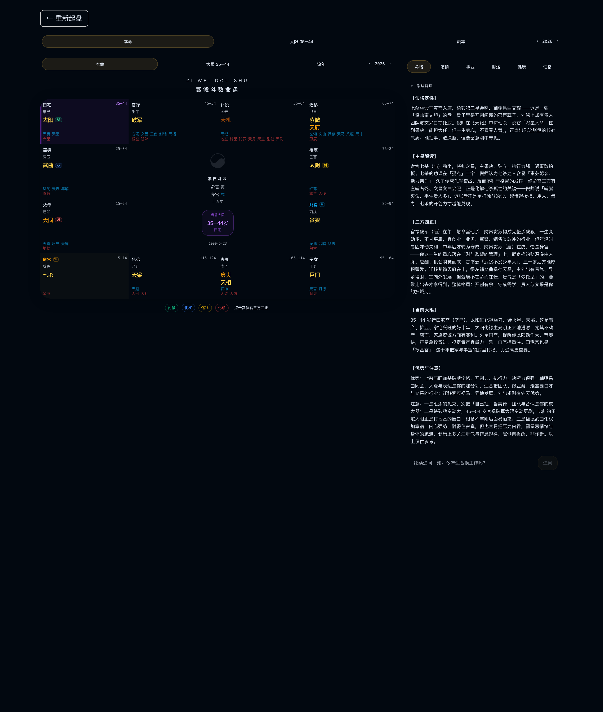

# dsh-ziwei-doushu · 紫微斗数 Harness 插件

把本地部署的 **[ziwei-doushu](https://github.com/Renhuai123/ziwei-doushu) 紫微斗数排盘应用**（含 AI 命理解读）接进 **DeepSeek Harness**：



- 左侧栏新增「紫微斗数」图标，点击在主区域打开完整应用
- 排盘、十二宫、四化、大限、AI「命理解读」、合盘分析、古籍库全部可用
- Host 半会自动守护本地应用服务：没运行就自动 `next start` 拉起（默认每 30 秒探测一次）
- 面板带原生工具栏：连接状态 / 重新加载 / 新窗口打开；服务不可用时显示原生的部署提示页

> ⚠️ 这是「伴生插件」：它不打包应用本身，需要你先在本机部署 ziwei-doushu（见下方「前置部署」）。
> 插件**不读取、不存储、不上传任何 API Key**；AI 解读的模型 Key 由你本地的应用 `.env.local` 管理。

## 前置部署（必须）

```bash
# 1) 克隆并构建 ziwei-doushu（Node.js ≥ 20.9）
git clone https://github.com/Renhuai123/ziwei-doushu.git ~/ziwei-doushu
cd ~/ziwei-doushu
npm ci
cp .env.example .env.local
npm run build

# 2)（可选）启用 AI 解读：在 .env.local 里填模型 Key，例如 DeepSeek
#    DEEPSEEK_API_KEY=sk-...      # 只保留在你的本机，插件不会读取
```

插件按下列顺序查找应用目录（找到含 `node_modules/next/dist/bin/next` 的第一个）：

1. 环境变量 `ZIWEI_APP_DIR`
2. `~/ziwei-doushu`
3. `~/Documents/ziwei-doushu`
4. `~/Documents/deepseek-harness/default-workspace/ziwei-doushu`

Node 可执行文件按 `ZIWEI_NODE_BIN` → 应用目录同级 `tools/node-*/bin/node` → Homebrew → `PATH` 查找。

## 安装

在 DSH 里直接对 Agent 说「安装 dsh-ziwei-doushu 插件」，或等它在 dshfind 广场上架后用 Discover 安装。
从 GitHub 安装时使用可复现的提交引用：

```
plugin_manager install_bundle(target='github:XuanCenXuKe/dsh-ziwei-doushu#5ed965d')
```

仓库地址：https://github.com/XuanCenXuKe/dsh-ziwei-doushu

安装后左侧栏会出现「紫微斗数」面板图标（第 20 位，位于「定时任务」与「Mnemon」之间）。

## 配置（可选环境变量）

| 变量 | 默认 | 说明 |
|---|---|---|
| `ZIWEI_APP_DIR` | 自动探测 | ziwei-doushu 部署目录 |
| `ZIWEI_NODE_BIN` | 自动探测 | Node 可执行文件路径 |
| `ZIWEI_AUTO_START` | `1` | 设为 `0` 关闭自动拉起（你自己管理服务时用） |

## 使用

1. 点左侧栏「紫微斗数」图标
2. 首次显示「连接中…」，Host 半会在 30 秒内探测并拉起本地服务
3. 连通后即为完整应用；顶部工具栏可「重新加载」或「新窗口打开」
4. 服务未启动时显示部署提示页（含手动启动命令、重试、仍要加载）

## 结构

```
├── package.json        # dsh.bundle + dsh.client 清单
├── cordis.patch.yml    # 插入 ziwei-doushu 这一行
├── index.js            # Host 半：本地服务守护
├── client.js           # Client 半：侧栏图标 + 主面板
├── locale/zh.json      # 插件管理页标题/描述（中文）
├── locale/en.json      # 同上（英文）
├── icon.svg            # 图标（原创星盘罗盘）
└── LICENSE             # MIT
```

## 设计说明与限制

- 面板用 **iframe 内嵌**本地已部署的完整应用，保证功能与上游应用一致、升级应用时插件无需改动；
  代价是应用保留自己的深色主题，不完全跟随 Harness 主题 token（Harness 自带「浏览器」侧栏标签也用同类做法）。
- 应用只监听 `127.0.0.1:3000`，数据与 Key 都在本机。
- 插件守护服务：想让服务彻底停下，请先禁用/卸载本插件（否则 30 秒内会被重新拉起）。
- 若面板空白（极少数浏览器安全策略拦截 iframe），点「新窗口打开」即可正常使用。
- 本插件与 ziwei-doushu 上游项目无隶属关系；应用代码遵循其 MIT 许可。

## License

MIT（本插件代码）。ziwei-doushu 应用及其数据集的许可见上游仓库。
